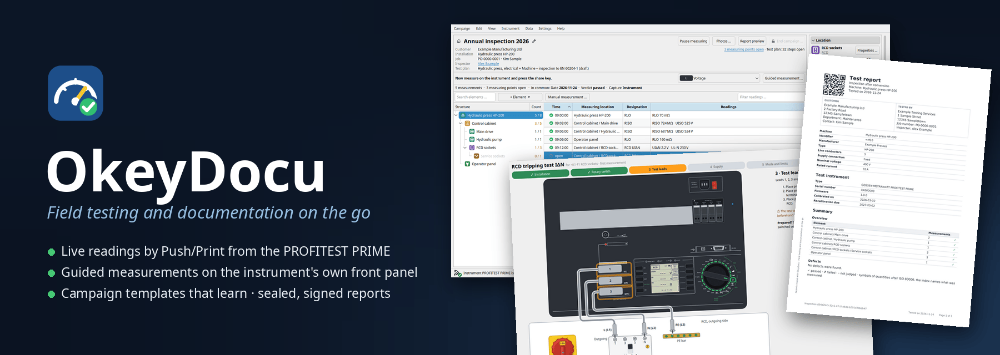
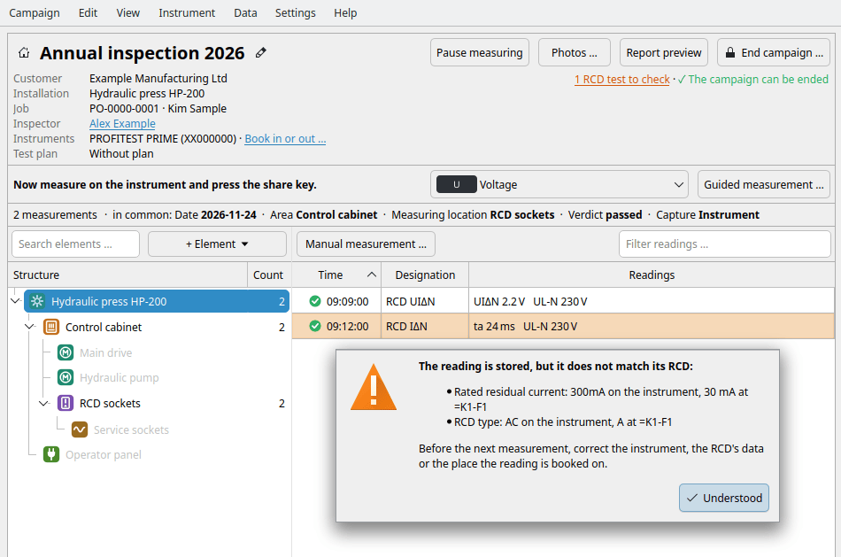
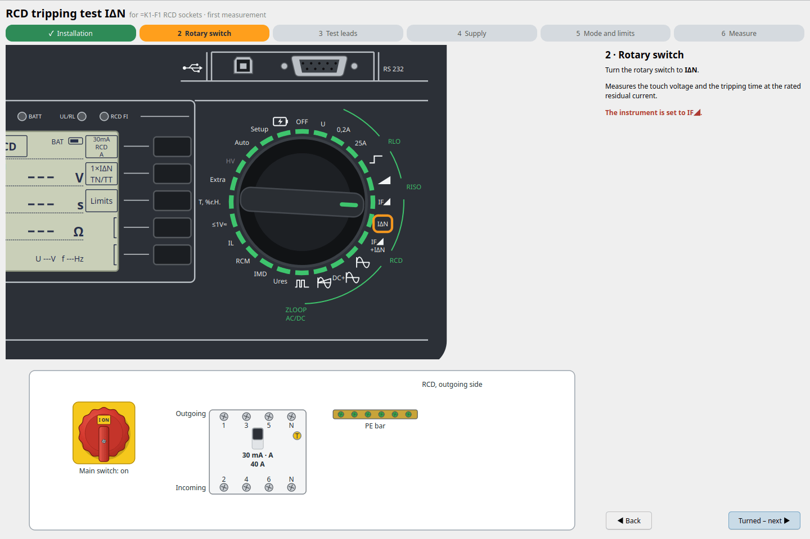
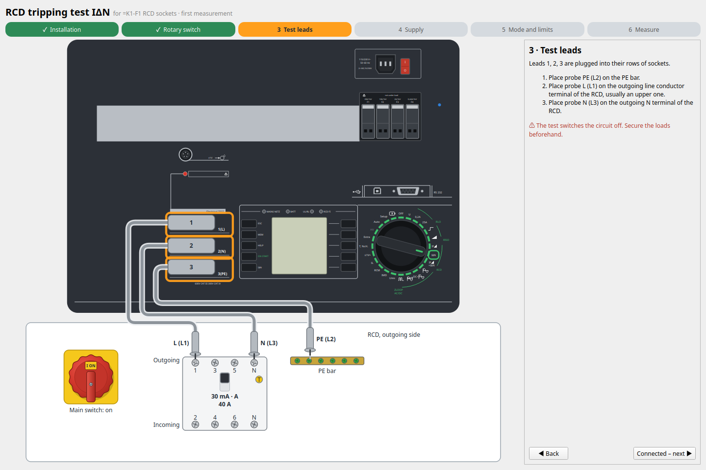
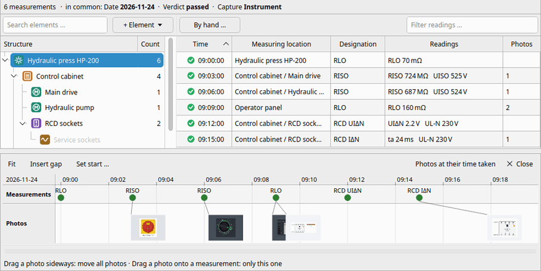
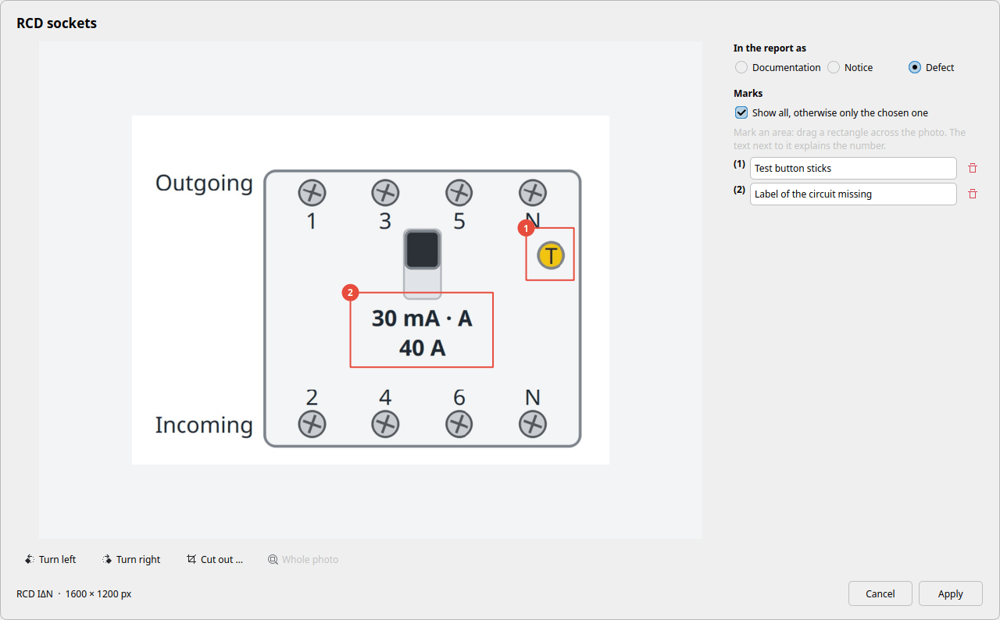
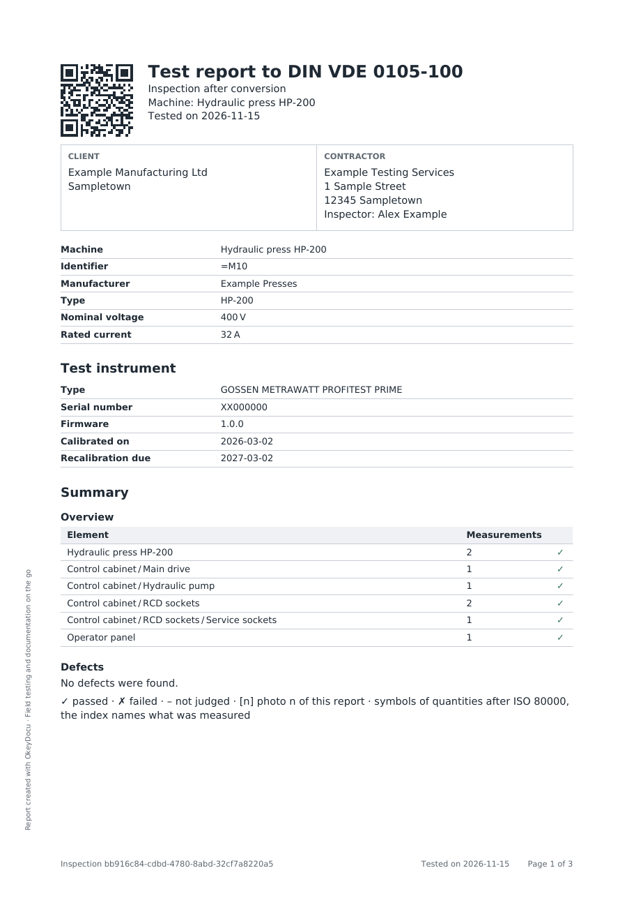

# OkeyDocu

OkeyDocu is for the people who keep electrical installations and machines safe: electricians,
inspectors and service engineers who spend their day between control cabinets, motors and RCDs.
They carry the measuring instrument; OkeyDocu is the laptop at their side. Every reading the
instrument sends lands in the right place of the installation the moment it is taken, photos find
their measurement by the time they were shot, and the test report comes together while the work
is still being done, not on the evening after.

It starts from what the inspector really meets. No structure has to be typed in before the first
measurement: elements are made on the way, where they are found. A measurement is guided step by
step on a drawing of the instrument's own front panel, from the rotary switch to the probes on
the terminals, and says which standard it rests on and why it is taken. The next one of its kind
runs the same steps and passes by what stays as it was. A finished inspection becomes a template
for the next one, and the template learns from every campaign until the order of the points, the
hints and the remarks are just right.

OkeyDocu is free software under the GPL. It is made for the Linux desktop, keeps all data on the
inspector's own computer and talks to the instrument over USB or Bluetooth. It is built and tried
on real inspections with the [GOSSEN METRAWATT](https://www.gossenmetrawatt.com) PROFITEST PRIME
and uses its Push/Print mode: the inspector measures on the instrument as always, and where the
store key would keep the result in the instrument's memory, the instrument prints it to its
interface instead, straight to OkeyDocu. Instruments are kept behind a driver interface, so others
can follow.

## What it does

**Measurement campaigns.** Every inspection is a campaign on an installation of a customer, with
its order number, contact person and inspector. The workspace is one framed table whose rows share
their edges. The first says what the campaign is, a line each for customer, installation,
inspector and plan, and holds what can be done with it: pause measuring, photos, report preview,
end the campaign, and beside them what is still open before it can be ended. The second says what
to do at the instrument now and
starts a guided measurement. The third holds the data: the readings in a table next to the
structure of the installation, like files next to folders. Dragging rows onto an element rebooks
them; the tree counts what has been measured this time against last time.

**Live readings by Push/Print.** In Push/Print mode the PROFITEST PRIME keeps nothing in its own
memory: the softkey that otherwise stores a result shares it instead, printed to the interface. The
result therefore exists only in OkeyDocu, which stores it before anything else happens and books it
on the element chosen. The measurement itself is started and run on the instrument. The instrument
clock is set at the start of a campaign. A silent instrument is probed, and the status bar says
whether it is connected. Readings the inspector stored in the instrument's memory while the link
was down are fetched later. Values can also be entered by hand, and a built-in simulator delivers
random readings for trying everything out without an instrument.

**Settings checked against the equipment.** An RCD test arrives with the settings the instrument
was set to: rated residual current, type and rated current. OkeyDocu holds them against what the
RCD states on its rating plate: the RCD at the measured element, the nearest one above it, or
the RCD in front that the machine states. A difference raises a warning the moment the reading
arrives, while the inspector still stands at the RCD and can measure again. The reading stays
stored, marked in the table and named in the checks above it until the instrument, the RCD's
data or the booking is put right. A setting the RCD does not state is named instead of judged.

**Several instruments, and the conditions of the test.** Further instruments are booked into a
campaign beside its own and out again while they have not measured; each reading names the
instrument it came from, and the report lists every instrument. A small Bluetooth climate sensor
(such as the LYWSD03MMC with the open pvvx firmware) is one of them: enrolled once under a name
of its own, pointed out by a face on its display, laid out at the equipment and watched until its
readings stand. Temperature and humidity are kept without a verdict and named in the report's
head as the test conditions, the sensor marked as not calibrated.

**Guided measurement.** A measurement is guided station by station, and each instrument brings
its own flow. With the PROFITEST PRIME there are six: installation, rotary switch, test leads,
supply, mode and limits, measure. The first station shows the structure tree: elements of every
kind are made, moved and deleted there while measuring. The drawn knob stands where the
instrument reports it, and the position to turn to pulses until the switch serves the
measurement. The leads are laid one by one from the sockets to the terminals of the test point:
an RCD, a main switch, a CEE plug, a Schuko plug, a monitoring device, a touchable part, the
cores of the supply cable. The supply station says whether to measure live or dead. Mode and
limits shows the key block of the instrument alone, with the softkeys to set beside their
labels, and names the standards with their clauses the measurement rests on and what it is taken
for. The softkeys of the drawing can be pressed: they switch the view or open the list of a
setting and work it as on the instrument, with the choice the element states marked. The last
station waits for the result, puts its values on the drawn display and says where further
readings are taken.

Guided are voltage, protective conductor with 200 mA and 25 A, insulation with constant and
rising voltage, the three RCD tests, the loop impedance in its four ways (with the full test
current, and three made for a circuit behind an RCD), residual voltage, the response of
insulation monitors and residual current monitors, the leakage current at touchable parts, the
current with a clamp and the voltage drop. The list to choose from shows each with the marking
printed at its position of the rotary switch.

A guide follows what the element states. A machine, a device or a piece of equipment states its
supply connection: fixed, CEE plug or Schuko plug. Protective conductor and insulation are then
measured at the supply terminals, at the pulled CEE plug or at the pulled Schuko plug, each with
its own picture of the leads. Where the RCD at the element is of type B, the guide for the loop
impedance warns of the methods this type rules out and points at the one that fits. An RCD of
the building installation is no part of a machine: the guide asks where the RCD stands, the
machine states the one in front of it, and the measurement is taken at its main switch.

**Repeating a measurement.** Once a campaign holds a reading of a kind, the next measurement of
that kind runs the same stations and passes two of them by: the rotary switch where the
instrument already stands right, and the test leads where the probes go where they already are.
Supply, mode and limits and the measurement itself are shown every time, because whether to
measure live or dead and the limits of a new element are asked every time.

**Line conductors.** Elements state how many line conductors and whether N reach them, inherited
down the tree. The instrument's AUTO runs measure every pair of conductors; readings against a
conductor that is not there are kept but marked as not applicable and left out of verdict and
report. The guided voltage measurement follows the statement: with three line conductors it
measures the 400 V between L1, L2 and L3 with the phase sequence first and the single voltages
after, with one only those; a voltage that does not fit what is expected is pointed out.

**Photos, placed by the time they were taken.** Photos from a phone or a camera are added to a
campaign in one go, and each finds its measurement by the time it was taken, read from its EXIF
data or its file name. A timeline shows measurements and photos as tracks, like in video editing,
with a line from every photo to its measurement. Where the camera's clock is off, dragging one
photo sideways moves all of them until they sit on their measurements; dragging a photo up onto a
measurement ties just this one; a gap moves everything after a pause. A photo that fits nowhere
waits on a stack and can be dropped onto a row of the table later, or onto an element of the
structure, where it lies as a picture of that element.

In the photo view a rectangle dragged across the photo becomes a numbered mark with its text, and
the photo is classed as documentation, notice or defect. It can be turned and cut; the original
file stays untouched as the evidence. The report prints the marks into the photo, the texts below
it, a defect in red.

**Test plans, repeat inspections and campaign templates.** A test plan leads through questions
and measurements in a wizard; a visual inspection to DIN VDE 0100-600 and, for a machine to
EN 60204-1, its inspection, its functional tests and its electrical test come as drafts, each
question with the clause it rests on; they are copied, changed and renamed in an
editor of their own. Any campaign takes any number of plans at any time, run in any order; each
must be worked off before the campaign is ended, and a step skipped with its reason counts as
worked off. A repeat inspection turns the last ended campaign into a list of open points. A
campaign template keeps the structure and the points of an inspection and can be used on the same
installation or copied onto another of the same build. As an open pattern it is edited along the
way and offers what a campaign did differently when it is ended; for series devices its points
and measurements are fixed, their order is free, and deviations need a reason.

**Reports.** Reports are made from templates in a graphical editor with live preview, letterhead
and logo, in German or English, chosen for each report. A template block can show none,
one or many measurements per element. Three templates come along: one ordered by element, a
compact one, and one that states the test plans first and then keeps each measured quantity
together in the order measured. One of them is the default for new campaigns. A campaign is given its template, and its preview shows
the report drawn with it. A report names the day measured on and, by the signature,
the day the campaign was ended. Ending a campaign seals the record;
archived PDFs carry a checksum and keep the template they were made with. Reports can be signed
as PAdES with an X.509 certificate from a PKCS#12 file or straight from an NSS database such as
the one of Firefox or Thunderbird; pinentry asks for the key password.

**Records that last.** Measured values, units and time stamps cannot be changed once stored;
content changes to a measurement are logged and marked in the report. Closed campaigns are sealed
in a chain, so a deleted or altered record is detected. Inspection intervals per kind of element
lead to due dates and follow-up orders on the overview. All readings of all campaigns can be
searched and filtered by customer, installation, campaign, quantity, verdict, period and value
range.

**Data import.** A day of testing from an IZYTRONIQ database copy is imported as a campaign,
with its structure, measurements and inspections.

**German and English, made for Full HD.** The user interface speaks German or English, with
dates and numbers written the way the language writes them. Everything the program brings along
follows the language, kinds of elements, their features, quantities and verdicts; names the
inspector types in stay as they were written. The language of a report is chosen on its own,
independent of the program's language: an inspection worked in German can go to the customer as
a report in English. The layout is made for Full HD screens (1920 × 1080), the usual
display of a laptop taken into the field.

## Status

OkeyDocu is in active development and has not had its first release. The test plans and limits
it ships are drafts for technical review; the inspector decides what applies to an inspection.

## Running

OkeyDocu needs Python 3.12 and PySide6 from the distribution (package `python3-pyside6`), so that
the Plasma style is used.

    tools/setup-venv.sh
    .venv/bin/python -m okeydocu

`tools/install-desktop-entry.sh` adds the program and its icon to the start menu of the user
(`--remove` takes both out again). Data is kept in `~/.local/share/OkeyDocu`; `OKEYDOCU_DATA`
selects another folder.

To try the program without an instrument and without data of your own:

    .venv/bin/python -m okeydocu --testproject prime

This starts it on an invented project in a folder of its own, with a simulated PROFITEST
PRIME: its front panel, dial, guides and setting lists, and random readings. A click on the
drawn dial turns the switch, and the last station of a guide has a button that measures. The
project is kept from start to start; `--fresh` begins it anew.

## Tests

    .venv/bin/python -m pytest

## Documentation

How the program is built is described in [docs/architecture.md](docs/architecture.md), the
instrument layer in [docs/hardware-abstraction.md](docs/hardware-abstraction.md), the rules the
surface follows in [docs/gui-design.md](docs/gui-design.md).

The pictures of this page are rendered from invented data by `tools/readme-images.sh`, which
writes them to `docs/images`.

## License

OkeyDocu is written by Thorsten Schnebeck, who holds all rights to it. The code is programmed
with Claude by Anthropic, used as a coding agent under his direction.

GPL-3.0-or-later, see [LICENSES](LICENSES/GPL-3.0-or-later.txt). The screenshots show invented
data. PROFITEST PRIME, IZYTRONIQ and GOSSEN METRAWATT are names of their owner. OkeyDocu is
not affiliated with it.
