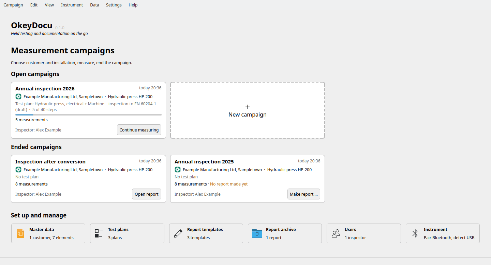

# OkeyDocu

OkeyDocu is for the people who keep electrical installations and machines safe: electricians,
inspectors and service engineers who spend their day between control cabinets, motors and RCDs.
They carry the measuring instrument; OkeyDocu is the laptop at their side. Every reading the
instrument sends lands in the right place of the installation the moment it is taken, photos find
their measurement by the time they were shot, and the test report comes together while the work
is still being done, not on the evening after.

It starts from what the inspector really meets. No structure has to be typed in before the first
measurement: elements are made on the way, where they are found. The first measurement of a kind
is guided step by step on a drawing of the instrument's own front panel, from the rotary switch to
the probes on the terminals; every one after that goes straight to its element. A finished
inspection becomes a template for the next one, and the template learns from every campaign until
the order of the points, the hints and the remarks are just right.

OkeyDocu is free software under the GPL. It is made for the Linux desktop, keeps all data on the
inspector's own computer and talks to the instrument over USB or Bluetooth. It is built and tried
on real inspections with the [GOSSEN METRAWATT](https://www.gossenmetrawatt.com) PROFITEST PRIME
and uses its Push/Print mode: the inspector measures on the instrument as always, and where the
store key would keep the result in the instrument's memory, the instrument prints it to its
interface instead, straight to OkeyDocu. Instruments are kept behind a driver interface, so others
can follow.

## What it does

**Measurement campaigns.** Every inspection is a campaign on an installation of a customer, with
its order number, contact person and inspector. Its readings stand in a table next to the
structure of the installation, like files next to folders. Dragging rows onto an element rebooks
them; the tree counts what has been measured this time against last time.

**Live readings by Push/Print.** In Push/Print mode the PROFITEST PRIME keeps nothing in its
own memory: the softkey that otherwise stores a result shares it instead, printed to the
interface. The result therefore exists only in
OkeyDocu, which stores it before anything else happens and books it on the element chosen. The
measurement itself is started and run on the instrument. The instrument clock is set at the start
of a campaign. Readings the inspector stored in the instrument's memory while the link was down
are fetched later. Values can also be entered by hand, and a built-in simulator delivers random
readings for trying everything out without an instrument.

**Settings checked against the equipment.** An RCD test arrives with the settings the instrument
was set to: rated residual current, type and rated current. OkeyDocu holds them against what the
RCD states on its rating plate, the RCD at the measured element or the nearest one above it. A
difference raises a warning the moment the reading arrives, while the inspector still stands at
the RCD and can measure again. The reading stays stored, marked in the table and named in the
checks above it until the instrument, the RCD's data or the booking is put right. A setting the
RCD does not state is named instead of judged.

**Guided first measurement.** The first measurement of a kind is guided station by station, and
each instrument brings its own flow. With the PROFITEST PRIME there are six: installation, rotary
switch, test leads, supply, mode and limits, measure. The program reads the position of the rotary
switch, lays the leads one by one from the sockets to the terminals of the test point (an RCD, a
main switch, a CEE plug), shows the instrument's display with the softkeys to set beside their
labels and waits for the result. Guided are voltage, protective conductor with 200 mA and 25 A,
insulation with constant and rising voltage, the three RCD tests, the loop impedance in its
four ways (with the full test current, and three made for a circuit behind an RCD) and residual
voltage. The first station shows the structure tree: elements of every kind are made, moved and
deleted there while measuring.

**Line conductors.** Elements state how many line conductors and whether N reach them, inherited
down the tree. The instrument's AUTO runs measure every pair of conductors; readings against a
conductor that is not there are kept but marked as not applicable and left out of verdict and
report. The guided voltage measurement follows the statement: with three line conductors it
measures the 400 V between L1, L2 and L3 with the phase sequence first and the single voltages
after, with one only those; a voltage that does not fit what is expected is pointed out.

**Photos, placed by the time they were taken.** Photos from a phone or a camera are added to a
campaign in one go, and each finds its measurement by the time it was taken, read from its EXIF
data or its file name. A timeline shows measurements and photos as tracks, like in video editing,
with a line from every photo to its measurement. Where the camera's clock is off, dragging one
photo sideways moves all of them until they sit on their measurements; dragging a photo up onto a
measurement ties just this one; a gap moves everything after a pause. A photo that fits nowhere
waits on a stack and can be dropped onto a row of the table later.

In the photo view a rectangle dragged across the photo becomes a numbered mark with its text, and
the photo is classed as documentation, notice or defect. It can be turned and cut; the original
file stays untouched as the evidence. The report prints the marks into the photo, the texts below
it, a defect in red.

**Test plans, repeat inspections and campaign templates.** A test plan leads through questions
and measurements in a wizard; a visual inspection to DIN VDE 0100-600 and an electrical machine
inspection come as drafts. Any campaign takes any number of plans at any time, run in any order;
each must be worked off before confirming. A repeat inspection turns the last confirmed campaign
into a list of open points. A campaign template keeps the structure and the points of an
inspection and can be used on the same installation or copied onto another of the same build. As
an open pattern it is edited along the way and offers what a campaign did differently when it is
confirmed; for series devices its points and measurements are fixed, their order is free, and
deviations need a reason.

**Reports.** Reports are made from templates in a graphical editor with live preview, letterhead
and logo, in German or English, chosen for each report. A template block can show none,
one or many measurements per element. Confirming a campaign seals the record;
archived PDFs carry a checksum and keep the template they were made with. Reports can be signed
as PAdES with an X.509 certificate from a PKCS#12 file or straight from an NSS database such as
the one of Firefox or Thunderbird; pinentry asks for the key password.

**Records that last.** Measured values, units and time stamps cannot be changed once stored;
content changes to a measurement are logged and marked in the report. Closed campaigns are sealed
in a chain, so a deleted or altered record is detected. Inspection intervals per kind of element
lead to due dates and follow-up orders on the overview. All readings of all campaigns can be
searched and filtered by customer, installation, campaign, quantity, verdict, period and value
range.

**Data import.** A day of testing from an IZYTRONIQ database copy is imported as a campaign,
with its structure, measurements and inspections.

**German and English, made for Full HD.** The user interface speaks German or English, with
dates and numbers written the way the language writes them. Everything the program brings along
follows the language, kinds of elements, their features, quantities and verdicts; names the
inspector types in stay as they were written. The language of a report is chosen on its own,
independent of the program's language: an inspection worked in German can go to the customer as
a report in English. The layout is made for Full HD screens (1920 × 1080), the usual
display of a laptop taken into the field.

## Status

OkeyDocu is in active development and has not had its first release. The test plans and limits
it ships are drafts for technical review; the inspector decides what applies to an inspection.

## Running

OkeyDocu needs Python 3.12 and PySide6 from the distribution (package `python3-pyside6`), so that
the Plasma style is used.

    tools/setup-venv.sh
    .venv/bin/python -m okeydocu

`tools/install-desktop-entry.sh` adds the program and its icon to the start menu of the user
(`--remove` takes both out again). Data is kept in `~/.local/share/OkeyDocu`; `OKEYDOCU_DATA`
selects another folder.

## Tests

    .venv/bin/python -m pytest

## Documentation

How the program is built is described in [docs/architecture.md](docs/architecture.md), the
instrument layer in [docs/hardware-abstraction.md](docs/hardware-abstraction.md).

## License

OkeyDocu is written by Thorsten Schnebeck, who holds all rights to it. The code is programmed
with Claude by Anthropic, used as a coding agent under his direction.

GPL-3.0-or-later, see [LICENSES](LICENSES/GPL-3.0-or-later.txt). The screenshots show invented
data. PROFITEST PRIME and GOSSEN METRAWATT are names of their owner; IZYTRONIQ belongs to
IZYTRON. OkeyDocu is not affiliated with either.
