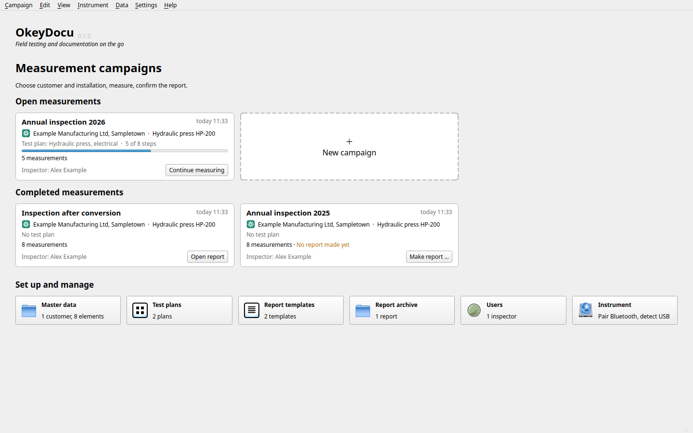
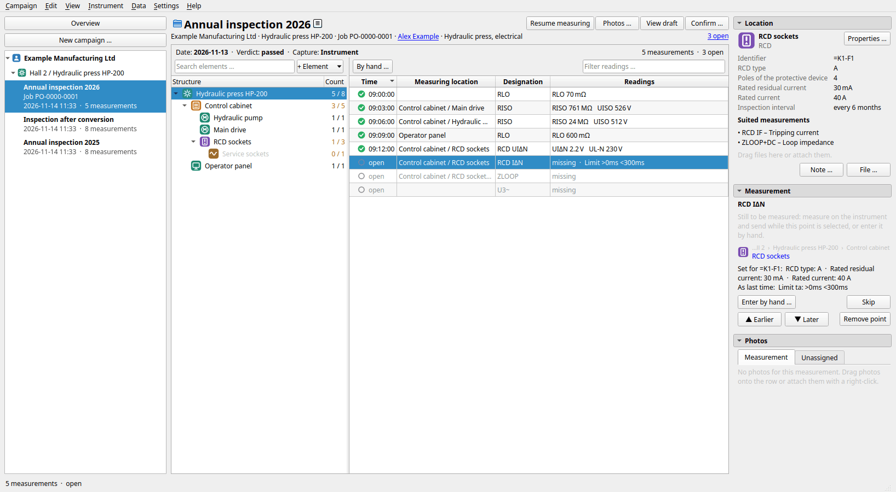
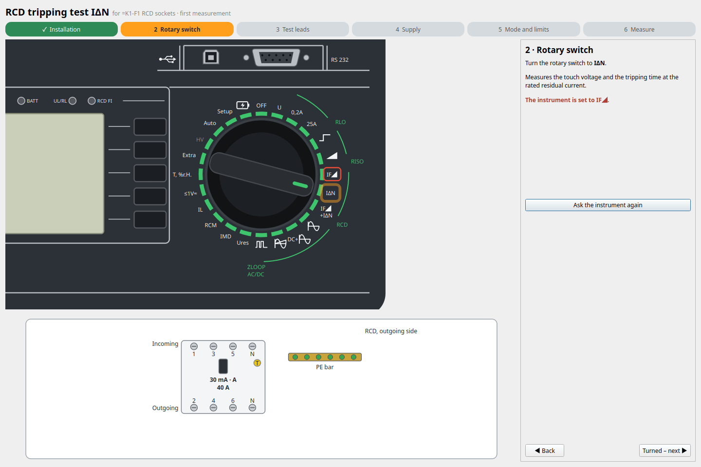
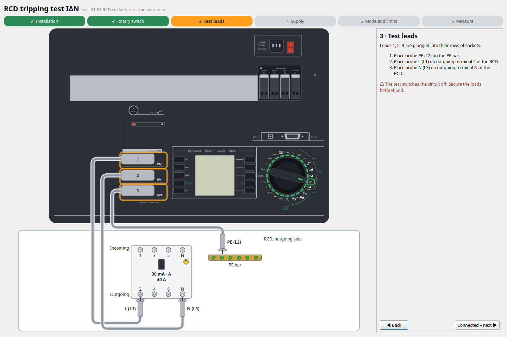
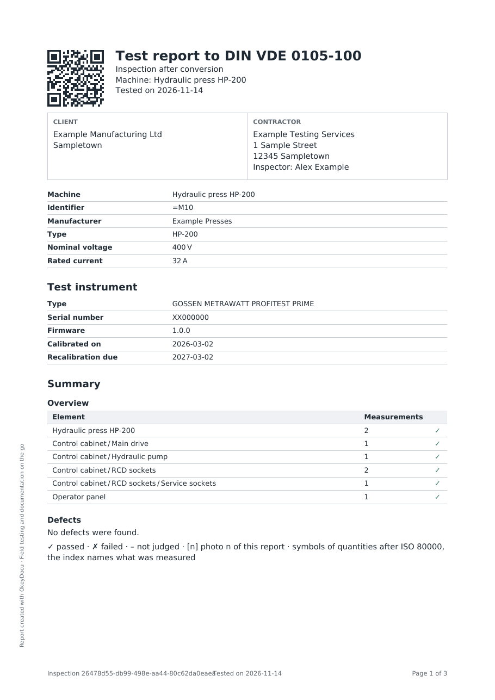

# OkeyDocu

*Field testing and documentation on the go*

OkeyDocu is for the people who keep electrical installations and machines safe: electricians,
inspectors and service engineers who spend their day between control cabinets, motors and RCDs.
They carry the measuring instrument; OkeyDocu is the laptop at their side. Every reading the
instrument sends lands in the right place of the installation the moment it is taken, photos find
their measurement by the time they were shot, and the test report comes together while the work
is still being done, not on the evening after.

It starts from what the inspector really meets. No structure has to be typed in before the first
measurement: elements are made on the way, where they are found. The first measurement of a kind
is guided step by step on a drawing of the instrument's own front panel, from the rotary switch to
the probes on the terminals; every one after that goes straight to its element. A finished
inspection becomes a template for the next one, and the template learns from every campaign until
the order of the points, the hints and the remarks are just right.

OkeyDocu is free software under the GPL. It is made for the Linux desktop, keeps all data on the
inspector's own computer and talks to the instrument over USB or Bluetooth. It is built and tried
on real inspections with a GOSSEN METRAWATT PROFITEST PRIME; instruments are kept behind a driver
interface, so others can follow.

## What it does

**Measurement campaigns.** Every inspection is a campaign on an installation of a customer, with
its order number, contact person and inspector. Its readings stand in a table next to the
structure of the installation, like files next to folders. Dragging rows onto an element rebooks
them; the tree counts what has been measured this time against last time.

**Live readings from the instrument.** With the PROFITEST PRIME connected, each saved
measurement arrives at once over Push/Print and is stored before anything else happens. The
instrument clock is set at the start of a campaign. Readings stored on the instrument while the
link was down are fetched later. RCD tests are checked against the RCD they are booked on; a
setting that differs from the rating plate raises a warning while the inspector can still repeat
the measurement. Values can also be entered by hand, and a built-in simulator delivers random
readings for trying everything out without an instrument.

**Guided first measurement.** The first measurement of a kind leads through six stations:
installation, rotary switch, test leads, supply, mode and limits, measure. The program reads the
position of the rotary switch, lays the leads one by one from the sockets to the terminals of the
test point (an RCD, a main switch, a CEE plug), names the softkeys to set and waits for the result.
Elements missing on the way are made there.

**Line conductors.** Elements state how many line conductors and whether N reach them, inherited
down the tree. The instrument's AUTO runs measure every pair of conductors; readings against a
conductor that is not there are kept but marked as not applicable and left out of verdict and
report.

**Photos.** Photos from a phone or camera are assigned to measurements by their time, from the
EXIF data or the file name. A timeline shows photos and measurements side by side for checking
and moving. Photos carry numbered marks classed as a note or a defect, and they appear in the
report with their marks.

**Test plans, repeat inspections and campaign templates.** A test plan leads through questions
and measurements in a wizard; a visual inspection to DIN VDE 0100-600 and an electrical machine
inspection come as drafts. A repeat inspection turns the last confirmed campaign into a list of
open points. A campaign template keeps the structure and the points of an inspection and can be
used on the same installation or copied onto another of the same build. In open mode it is edited
along the way and offers what a campaign did differently when it is confirmed; in series mode its
points are fixed and deviations need a reason.

**Reports.** Reports are made from templates in a graphical editor with live preview, letterhead
and logo, in German, English or Spanish independently of the program's language. A template block
can show none, one or many measurements per element. Confirming a campaign seals the record;
archived PDFs carry a checksum and keep the template they were made with. Reports can be signed
as PAdES with an X.509 certificate from a PKCS#12 file or straight from an NSS database such as
the one of Firefox or Thunderbird; pinentry asks for the key password.

**Records that last.** Measured values, units and time stamps cannot be changed once stored;
content changes to a measurement are logged and marked in the report. Closed campaigns are sealed
in a chain, so a deleted or altered record is detected. Inspection intervals per kind of element
lead to due dates and follow-up orders on the overview. All readings of all campaigns can be
searched and filtered by customer, installation, campaign, quantity, verdict, period and value
range.

**Data import.** A day of testing from an IZYTRONIQ database copy is imported as a campaign,
with its structure, measurements and inspections.

## Status

OkeyDocu is in active development and has not had its first release. The test plans and limits
it ships are drafts for technical review; the inspector decides what applies to an inspection.

## Running

OkeyDocu needs Python 3.12 and PySide6 from the distribution (package `python3-pyside6`), so that
the Plasma style is used.

    tools/setup-venv.sh
    .venv/bin/python -m okeydocu

`tools/install-desktop-entry.sh` adds the program and its icon to the start menu of the user
(`--remove` takes both out again). Data is kept in `~/.local/share/OkeyDocu`; `OKEYDOCU_DATA`
selects another folder.

## Tests

    .venv/bin/python -m pytest

## Documentation

How the program is built is described in [docs/architecture.md](docs/architecture.md), the
instrument layer in [docs/hardware-abstraction.md](docs/hardware-abstraction.md).

## License

Written by Thorsten Schnebeck. GPL-3.0-or-later, see [LICENSES](LICENSES/GPL-3.0-or-later.txt).
The screenshots show invented data.
